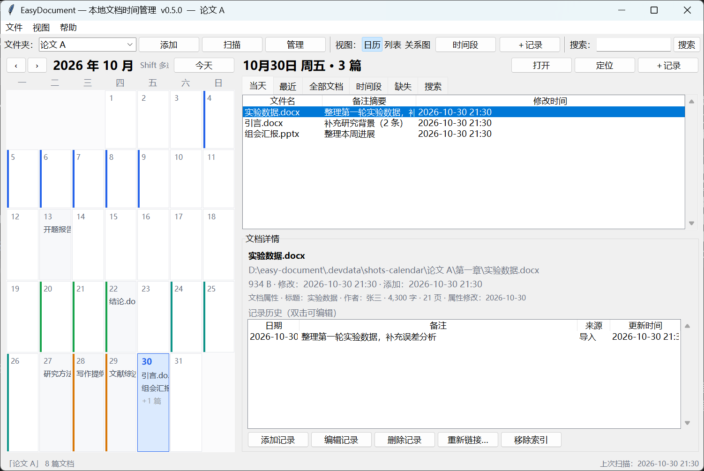
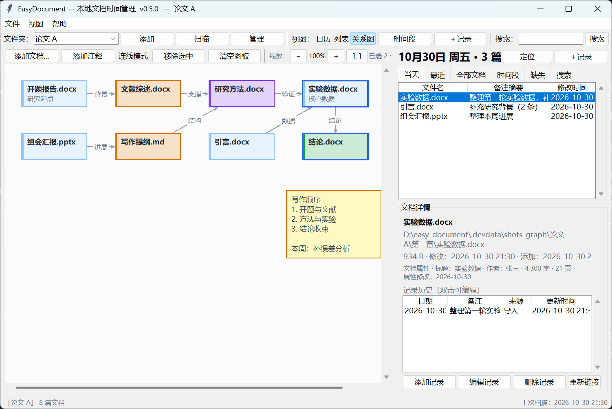

# EasyDocument

**以文件夹为中心、按时间回看本地文档的 Windows 桌面工具。**

EasyDocument 为 Word、PowerPoint 与 Markdown 文档建立本地索引，用日历、时间轴和关系图记录并回顾“哪天动过哪些文档、当时做了什么”。它只管理文档的路径、元数据、日期记录和备注，**不读取、不修改文档正文**；所有数据保存在本机 SQLite，运行时不联网，也不依赖第三方 Python 包。

当前版本：**v0.1**



## 功能

- **多文件夹管理**：添加或移除受管文件夹，递归扫描 Word（`.doc` / `.docx` / `.docm`）、PowerPoint（`.ppt` / `.pptx` / `.pptm`）和 Markdown（`.md`）；新文件可手动勾选入库或自动入库。
- **日历与记录**：有记录的日期在月历上标色，点日期查看当天文档；可为任意日期补一条带备注的记录，类似 commit message，随时编辑、改日期或删除。
- **时间段**：按住 Shift 连选多日，划成一个“开题阶段”“实验阶段”等时间段，支持 20 种预设颜色和自定义取色，日历显示色条。
- **列表 / 时间轴**：按天或按时间段分组浏览，没有记录的文档归入“未归类文档”。
- **关系图**：自选文档加入图板，拖动排版、连线并添加标签；节点可按时间段自动染色或单独染色，支持 Ctrl 多选、批量注释、字号调整、Ctrl+滚轮缩放和 Ctrl+Z 撤销。还可以添加与文档无关的自由注释块。
- **搜索与缺失处理**：按文件名或备注搜索并跳转；文件移动或改名后，同卷内扫描可自动重连；跨卷或替换文件时提供手动重新链接，历史记录不丢。
- **文件操作**：用默认关联程序打开文档，或在 Windows 资源管理器中定位。
- **拖入移动**：从资源管理器把文件拖进窗口，移动到当前或指定文件夹；同名文件自动改名，绝不覆盖，已索引文件保留全部日期记录。
- **导出与备份**：导出全部数据为 JSON，或导出全部记录为 Excel 可直接打开的 CSV；每日自动备份数据库，数据目录可迁移到其它磁盘。
- **本地、轻量、零依赖**：Python + Tkinter/ttk + SQLite，均为标准库；数据与程序分离，关闭程序后不驻留后台。

关系图视图（时间段染色、节点注释、连线与自由注释块）：



## 下载与运行

### Windows 免安装版（推荐）

1. 打开本仓库的 **Releases** 页面。
2. 下载最新的 Windows 压缩包。
3. 解压到任意目录，双击 `EasyDocument.exe` 即可，无需安装 Python。

> 发布包是 PyInstaller 打包的 **onedir** 免安装目录，请保留解压后的整个文件夹，不要只复制 exe。
> 程序暂未做代码签名，首次运行时 Windows SmartScreen 可能提示“已保护你的电脑”；确认来源后可选择“更多信息 → 仍要运行”。

程序数据默认写入 `%APPDATA%\EasyDocument\`，不会写入程序目录，可启动后手动指定数据保存路径。

### 从源码运行

需要 Python 3.10+（Windows 官方安装包自带 Tkinter），无需安装任何第三方包：

```powershell
python main.py
```

临时指定数据目录（不修改保存的位置）：

```powershell
python main.py --data-dir D:\EasyDocumentData
```

也可以手动打包，在项目文件夹中打开powereshell运行：
powershell -ExecutionPolicy Bypass -File .\build_autopublish.ps1


## 快速上手

1. 点工具栏“添加”，选择一个存放文档的文件夹，按需勾选“包含子文件夹”和“自动入库”。
2. 扫描完成后，在导入向导里确认要纳入索引的文件和入库日期。
3. 在月历上点某一天，右侧会列出当天文档；双击文档即可打开。
4. 选中文档后点“＋记录”，补一条带日期和备注的工作记录；之后可在日历上回看。
5. 需要整体回顾一段时间时，切换到“列表”或“关系图”视图；需要备份时使用“文件 → 导出 JSON / CSV”。

## 数据与备份

- 默认数据目录：`%APPDATA%\EasyDocument\`，包含 `app.db`、`logs\`、`backups\`。
- 可以迁移到其它磁盘：`文件 → 数据位置…`，`%APPDATA%` 下只保留一个很小的路径指针 `location.json`。
- 数据目录优先级：`--data-dir` 参数 > `EASY_DOCUMENT_DATA` 环境变量 > `location.json` > 默认位置。
- 每天首次启动会自动备份数据库，默认保留最近 7 份；也可在“文件”菜单中手动备份。
- 卸载时删除数据目录即可，不会影响你的任何文档文件。

## 项目结构

```text
main.py                     程序入口
easy_document/
  config.py / storage.py    配置、数据目录与迁移
  db.py / repo.py           数据库连接、建表迁移与全部数据访问
  dates.py                  日期工具
  scanner.py                文件夹扫描与文件识别
  fileops.py                打开、定位与拖入移动
  docx_meta.py              .docx / .pptx 核心属性读取
  exporter.py               JSON / CSV 导出
  ui/                       主窗口、日历、列表、关系图、对话框与拖放接入
tests/                      单元测试
images/                     README 截图
requirements.md             需求规格说明
```

## 技术栈

- Python 3.10+、Tkinter/ttk、SQLite（全部来自标准库）。
- Windows 10/11；界面为原生桌面风格。
- 运行时零第三方依赖；PyInstaller 仅用于生成 Windows 免安装包，不参与运行。

## 已知限制

- 不读取、不解析文档正文，因此**不支持全文检索**，也不是文档编辑器。
- `.docx` / `.docm` / `.pptx` / `.pptm` 会额外读取标题、作者、字数、页数、幻灯片数等核心属性；老格式 `.doc` / `.ppt` 为 OLE 二进制，标准库无法解析这些属性。
- 关系图是手工排版与连线，不做自动布局或图算法分析，也不导出为图片。
- 导出为一次性文件导出，暂不支持从 JSON/CSV 导入还原。
- 不做文档内容版本快照、云同步或多人协作。
- 拖入移动仅 Windows 生效；若应用以管理员权限运行而资源管理器未提权，Windows 的 UIPI 可能拦截拖放，普通权限运行即可。


